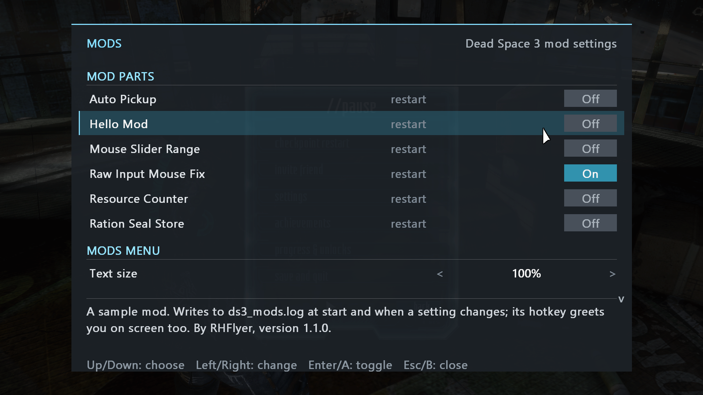

# DS3 Mod Loader

**Mods for Dead Space 3 on PC, switched on and off from inside the game.**

One small file (`dinput8.dll`) next to the game adds a **Mods panel** to the pause menu and a simple way for anyone
to make and share their own mods. No game files are changed: delete the files and the game is as it was. What
add-ons already saved stays on that save, for example what you bought in the Ration Seal Store.

Dead Space 3 never got a proper modding scene on PC, and even experienced modders struggled with it. I wanted to
help in some way, so I tried my hand at making tools that give everyone easier access to mods. If you make
something with it, I'd love to see it.



## What you get

| | |
|---|---|
| **Mods panel** | Pause > "mods" (or F11, or Back on a pad). Every mod's switch and the settings it lists, saved at once. |
| **Drop-in mods** | A mod is one folder in `plugins\`. New mods start off until you switch them on. |
| **A mod kit** | Everything you need to make your own mods, with a beginner guide. |

The loader itself changes nothing in how the game plays. Every feature is an **optional add-on**, made with the
same kit anyone can use, with its source to learn from. All six come in one add-ons download; install only the
ones you want.

- **Raw Input Mouse Fix**: 1:1 mouse aim, without the game's acceleration and camera smoothing. Based on
  [slopkhayzo's fix](https://github.com/slopkhayzo/DeadSpace3-RawInputMouseFix), rebuilt as an add-on.
- **Ration Seal Store**: spend Ration Seals in the game's store again, on resource packs, circuit packs, schematics
  and weapon-part unlocks. Seals only, never real money. The Resource Pack also gives one standard weapon part from
  the tables the game shipped but never used.
- **Auto Pickup**: collects dropped items all around you without an Ammo Sweeper on your weapon, and lists what
  you just picked up.
- **Resource Counter**: your six resources in a corner of the screen.
- **Mouse Slider Range**: a wider range for the game's mouse sensitivity slider. It does nothing while the Raw Input
  Mouse Fix's 1:1 aim is active: the fix replaces the game's mouse speed and follows only where the slider is, not
  its range.
- **Hello Mod**: the smallest example mod, a hotkey that says hello.

## Install (players)

1. **Back up your saves**: copy `Documents\EA Games\Dead Space 3` somewhere safe.
2. Download `ds3-mod-loader-v1.0.0.zip` from [Releases](https://github.com/RHFlyer/DS3-Mod-Loader/releases).
3. Unzip it into the game folder, next to `deadspace3.exe` (Steam: right-click Dead Space 3 > Manage > Browse
   local files). That adds `dinput8.dll`, `ds3_mods.ini`, a `plugins` folder for add-ons and a
   `DS3 Mod Loader docs` folder.
4. Start the game, pause, and choose **mods**.

Add-ons: download `ds3-mod-loader-addons-v1.0.0.zip`, unzip it anywhere and read `READ ME FIRST.txt`. Copy the
folder of each mod you want into `plugins\` in the game folder, switch it on in the Mods panel, and restart the
game. For 1:1 mouse aim, that's the Raw Input Mouse Fix; the game's own Mouse Sensitivity slider still sets its
speed.
Updating an add-on: close the game and copy the new folder over the old one; your switch and settings stay.
Full steps, uninstall and known issues: [`dist/README.txt`](dist/README.txt) (in the download:
`DS3 Mod Loader docs\README.txt`).

## Make your own mod

You don't need to be a programmer to start:

- **Patch mods** change a few bytes of the game with nothing but a text file (`mod.ini`). Mouse Slider Range is one.
- **DLL mods** use a small C++ SDK for drawing on screen, reading resources and items, and hooking the game safely,
  with hot reload while the game runs. The other five add-ons are DLL mods.
- Already have an ASI mod? The guide shows how to drop it into `plugins\` as it is, or rebuild it with the SDK, as
  was done for the Raw Input Mouse Fix.

The add-ons are deliberately different from each other: a mouse fix, a store, an item collector, an on-screen
counter and a one-line number change all run on the same kit. Try something unusual.

Start with the beginner guide, [`sdk/README.md`](sdk/README.md): what you need, a word list, your first patch mod and
your first DLL mod, and how to release and update a mod. The source download (`ds3-mod-loader-source-v1.0.0.zip`)
has the guide, `ds3mod.h` and the source of every add-on. Known game addresses are in
[`sdk/GAME_NOTES.md`](sdk/GAME_NOTES.md), and a read-only memory inspector is in
[`scripts/ds3_mcp.py`](scripts/ds3_mcp.py) (in the source download it is in `sdk\tools\`).

## Building from source

Needs Windows, [Git](https://git-scm.com/download/win), Build Tools for Visual Studio 2022 (on the downloads page
under "Older Downloads"; "Desktop development with C++") and CMake. Use `git clone` as below: GitHub's "Download
ZIP" leaves out MinHook (`third_party/minhook`), and the build fails without it.

```
git clone --recurse-submodules https://github.com/RHFlyer/DS3-Mod-Loader
cd DS3-Mod-Loader
cmake -S . -B build -A Win32
cmake --build build --config Release
```

`build\Release\dinput8.dll` is the loader; each sample mod is ready in `build\plugins\<Mod>\`.
`scripts\package-release.ps1` builds the release zips locally.

## Good to know

- Made for the **Steam** version of Dead Space 3. Tested at 1920x1080 with keyboard and mouse.
- **Co-op hasn't been tested.** If you try it, please report what happens.
- If something goes wrong, open an issue and attach `ds3_mods.log` from the game folder. The log writes your folders
  as `<game>` and `%USERPROFILE%`, so your Windows user name isn't in it.
- A DLL mod is a program: only install mods from people you trust.

## How this was made

This project was made with a lot of help from AI. AI assistants (Claude and Codex) helped me find things in the
game, write and review the code, and write these texts. I decided what to build and tested every release in the game
myself. AI can get things wrong, so if something looks off, it may well be: please tell me, or fix it.

Dead Space 3 is a hard game to mod. It has no official mod tools, its engine was never made public, and Visceral
Games, the studio that made it, closed in 2017. The game also comes with no names for its code: opened in a
decompiler, every function is just a number, like `FUN_00632d90`. Before you can change anything, you have to work
out what that code does, one function at a time. That is where AI was a real necessity. It read through the
decompiled code with me, suggested what each function might be, and we tested those guesses in the running game until they held up. The
addresses in [`sdk/GAME_NOTES.md`](sdk/GAME_NOTES.md) came out of that work, so nobody has to start from zero again.

## Contributing

Fixes, new findings and updates are very welcome, from beginners and experts alike. You don't need to ask first.

- **Found a bug, or something that's wrong in the guide?** Open an issue. Attach `ds3_mods.log` if the game was
  involved.
- **Found where something lives in the game?** Add it to [`sdk/GAME_NOTES.md`](sdk/GAME_NOTES.md) so the next
  modder doesn't have to look again.
- **Fixed or improved something?** Send a pull request. Small ones are great.
- **Made a mod?** Share it in your own repo or wherever you like, and open an issue to tell me. I'd love to see it.

How to do each of these: [`CONTRIBUTING.md`](CONTRIBUTING.md).

## Rules for every mod

This project never touches paid DLC, entitlements, ownership or the game's copy protection, and mods made with it
must not either. The loader refuses patches and hooks in the store, login and paid-content code it knows about;
the rule covers the rest.

## Credits and licence

MIT licence ([`LICENSE.txt`](LICENSE.txt)). Built on [MinHook](https://github.com/TsudaKageyu/minhook) (BSD 2-clause).
The Raw Input Mouse Fix add-on is based on the
[Raw Input Mouse Fix](https://github.com/slopkhayzo/DeadSpace3-RawInputMouseFix) by **slopkhayzo** (MIT); thank you
for making and sharing it. See [`THIRD-PARTY-NOTICES.txt`](THIRD-PARTY-NOTICES.txt).

Dead Space 3 is a trademark of Electronic Arts Inc. This project is not made, endorsed or supported by Electronic
Arts and contains no game files.
